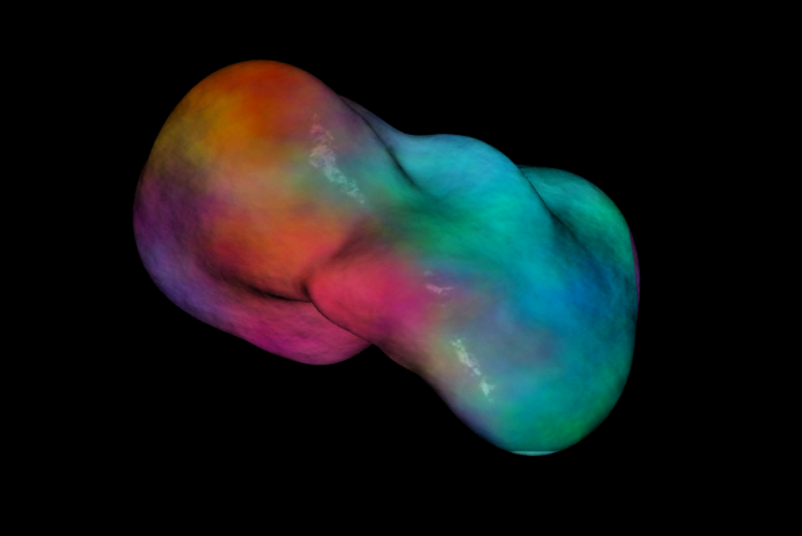

<main class="grid-page">

    

    

        Mat Warren is a musician, sound engineer and creative technologist based in Leitrim, Ireland. His work moves between sound, music, technology and performance. Through installations, releases, live productions and experimental systems, his practice explores the relationship between physical interaction and sound.
    

    

    <h1>JOURNAL</h1>

    

    

        <article class="project-tile project-tile-large" data-category="selected-projects">

            <a href="projects/yats.html" class="project-tile-link">

                

                

                    <h2>YOU ARE THE SIGNAL (YATS)</h2>

                    

                        Interactive audiovisual installation
                    

                    

                        18.09.2026
                    

                    

                        <!-- 

                            An interactive audiovisual installation where the
                            movement of participants shapes sound and projected
                            visuals in real time.
                        

                        

                            Developed for Culture Night 2026 at The Dock in
                            Carrick-on-Shannon.
                        
 -->

                    

                

            </a>

        </article>

       

    

</main>