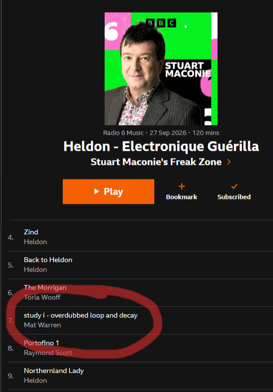
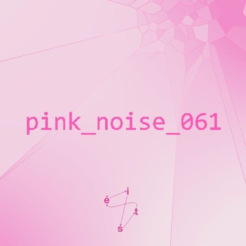
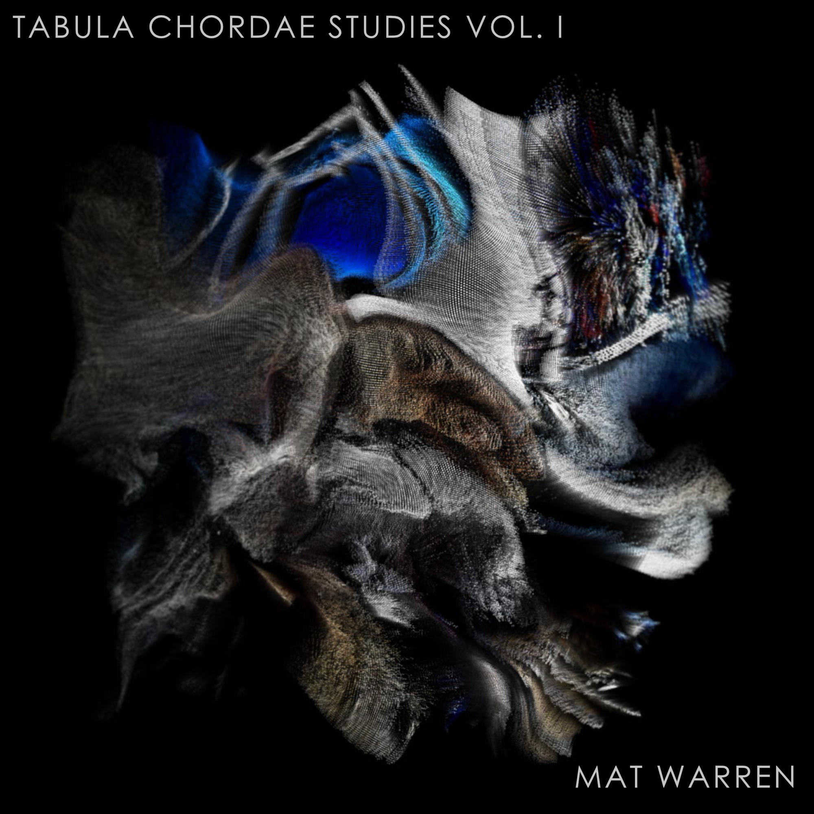

<main class="grid-page">

    

    

        Mat Warren is a musician, sound engineer and creative technologist based in Leitrim, Ireland. His work moves between sound, music, technology and performance. Through installations, releases, live productions and experimental systems, his practice explores the relationship between physical interaction and sound.
    

    

    <h1>JOURNAL</h1>

    

        <!-- -----------------------------------------------------2026---------------------------------------------- -->

        <!-- ================================================= -->
        <!-- BBC RADIO 6 MUSIC -->
        <!-- ================================================= -->

        <article class="project-tile project-tile-tall" data-category="music">

            <a href="https://on.soundcloud.com/AL6rEVEMz96ft7Gahc" class="project-tile-link">

                

                

                    <h2>BBC RADIO 6 MUSIC</h2>

                    

                        Stuart Maconie's FreakZone · 27.09.2026
                    

                    <!-- 

                        

                            Radio play on BBC Radio 6 Music's FreakZone
                            with Stuart Maconie.
                        

                    
 -->

                

            </a>

        </article>

        <!-- ================================================= -->
        <!-- YOU ARE THE SIGNAL -->
        <!-- ================================================= -->

        <article class="project-tile project-tile-large" data-category="selected-projects">

            <a href="projects/yats.html" class="project-tile-link">

                

                

                    <h2>YOU ARE THE SIGNAL (YATS)</h2>

                    

                        Interactive audiovisual installation
                    

                    

                        18.09.2026
                    

                    

                        <!-- 

                            An interactive audiovisual installation where the
                            movement of participants shapes sound and projected
                            visuals in real time.
                        

                        

                            Developed for Culture Night 2026 at The Dock in
                            Carrick-on-Shannon.
                        
 -->

                    

                

            </a>

        </article>

        <!-- ================================================= -->
        <!-- éist Radio Play-->
        <!-- ================================================= -->

        <article class="project-tile project-tile-large" data-category="selected-projects music">

            <a href="projects/eist_radio150726.html" class="project-tile-link">

                

                

                    <h2>éist Radio</h2>

                    

                        Radio Play - 15.07.26
                    

                    <!-- 

                        

                        

                        

                        

                        

                        

                    
 -->

                

            </a>

        </article>

        <!-- ================================================= -->
        <!-- TABULA CHORDAE -->
        <!-- ================================================= -->

        <article class="project-tile project-tile-tall" data-category="selected-projects music">

            <a href="projects/tabula-chordae.html" class="project-tile-link">

                

                

                    <h2>TABULA CHORDAE STUDIES VOL. I</h2>

                    

                        Musical release · 2026
                    

                    <!-- 

                        

                            Recordings documenting the earliest explorations
                            of a self-built string instrument: a hollow-bodied,
                            twin-neck table steel.
                        

                        

                            Slow ambient passages sit alongside distorted
                            loops, freeform improvisations, unstable textures,
                            repetition, noise and melodic playing.
                        

                        

                            These recordings are studies rather than
                            definitive compositions — documents of learning,
                            experimentation and discovery.
                        

                    
 -->

                

            </a>

        </article>

                <!-- ================================================= -->
        <!-- éist Radio Play-->
        <!-- ================================================= -->

        <article class="project-tile project-tile-large" data-category="selected-projects music">

            <a href="projects/eist_radio200526.html" class="project-tile-link">

                

                

                    <h2>éist Radio</h2>

                    

                        Radio Play - 20.05.26
                    

                    <!-- 

                        

                        

                        

                        

                        

                        

                    
 -->

                

            </a>

        </article>

    

</main>